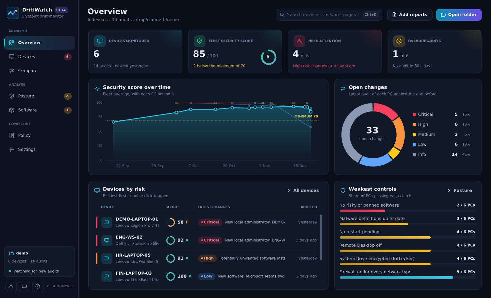
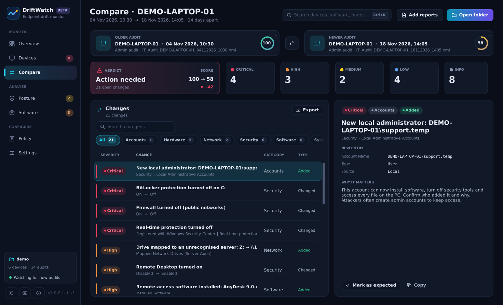
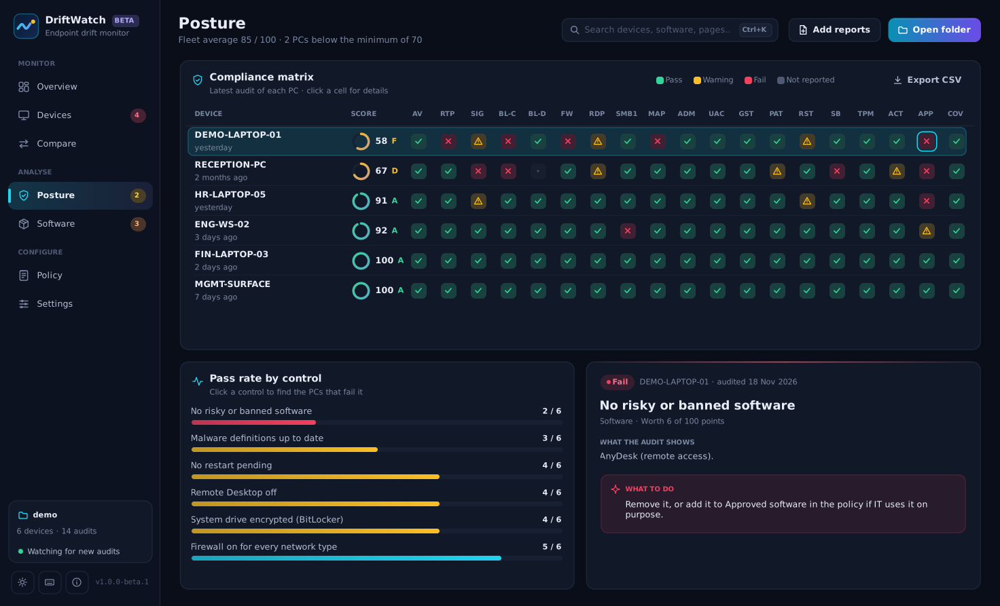

<p align="center">
  
</p>

<h1 align="center">DriftWatch</h1>

<p align="center">
  Security drift monitoring for Windows PCs, built on <a href="https://flickerdampa.github.io/devicedossier/">DeviceDossier</a> audits.<br>
  Score every PC, see what changed since the last audit, and catch the risky changes first.
</p>

<p align="center">
  
  
  
  
</p>

<p align="center">
  Built by <a href="https://flickerdampa.github.io/">FlickerDampa</a>, security researcher and engineer.
</p>

<p align="center">
  
</p>

---

## Why

A single audit tells you what a PC looks like today. It can't tell you that someone added an admin account last
Tuesday, that antivirus was switched off, or that a laptop started mapping a drive to a server nobody recognises.

Point DriftWatch at the folder where DeviceDossier saves its XML reports. It groups them by PC, scores each audit
against 20 security checks, and compares every audit with the one before. You get a fleet overview, a ranked list
of what changed, and a clear note on why each change matters.

It only reads the XML reports you give it. It never touches or contacts the PCs they describe, and it works offline.

## What's inside

| | |
|---|---|
| **Overview** | Devices monitored, fleet security score, PCs that need attention and overdue audits. Score trend over time, open changes by severity, and the weakest controls. |
| **Devices** | Every PC with its score, trend, latest changes, OS and last audit. Filter by attention, overdue, below minimum, laptops or desktops. |
| **Device details** | Identity card and score gauge, score history, hardware and system facts, every security check with advice, an audit timeline, and a browser for the raw report data. |
| **Compare** | Any two audits of a PC side by side. Changes ranked Critical to Info with before and after values. Filter by severity or category, search, mark changes as expected, export. |
| **Posture** | A compliance matrix of every PC against every check, pass rates per control, and what to do about each failure. |
| **Software** | Every program across the fleet from each PC's latest audit. Flags remote-access, tunnelling, torrent and admin tools. Ban, approve or require a program in one click. |
| **Policy** | Your rules: banned, approved and required software, approved admin accounts, thresholds for patch age, definitions age, overdue audits and minimum score. Import and export as JSON. |
| **Watching** | DriftWatch watches the folder and re-checks when DeviceDossier saves a new audit, with a notification when a PC picks up high-risk changes. |

<p align="center">
  
</p>

## Security score

Each audit is checked against these controls. Passes earn the full weight, warnings half, and checks the audit
couldn't report are left out rather than counted against the PC. A failure on a heavy control (antivirus,
real-time protection or BitLocker on the system drive) caps the score at 69, so a PC with protection switched off
can never look healthy.

| Group | Checks |
|---|---|
| Endpoint protection | Antivirus or EDR installed · real-time protection on · malware definitions up to date |
| Encryption | System drive encrypted · other drives encrypted |
| Network exposure | Firewall on for every network type · Remote Desktop off · SMBv1 off · mapped drives point to known servers |
| Identity and access | Local administrators kept to a minimum (and on your approved list) · UAC on · Guest account off |
| Updates | Security updates installed recently · no restart pending |
| Platform | Secure Boot on · TPM present and ready · Windows activated |
| Software | No risky or banned software · required software installed |
| Audit | Complete audit, run as administrator |

Grades: A 90+, B 80+, C 70+, D 60+, F below 60.

<p align="center">
  
</p>

## What a comparison catches

Every change between two audits gets one of five levels. A few examples:

| Level | Examples |
|---|---|
| **Critical** | New local administrator · antivirus real-time protection off · antivirus removed · BitLocker turned off · firewall off on public networks · drive being decrypted |
| **High** | Remote Desktop turned on · Secure Boot, UAC or a firewall profile off · SMBv1 or the Guest account turned on · a drive mapped to an unrecognised server · remote-access, tunnelling or torrent software installed · banned software installed · required or security software removed · domain changed · Windows reinstalled |
| **Medium** | DNS servers changed · new VPN adapter · software or Windows rolled back · RAM or drives added · drive or battery health falling fast · Windows no longer activated · Defender signatures out of date |
| **Low** | New software or browser extensions · software removed · restart pending · BIOS updated |
| **Info** | Updates installed · monitors connected · IP address changes · good news, such as a firewall turned back on |

Direction matters: a firewall going **On → Off** is High or Critical, while **Off → On** is good news. Rows are
matched by identity (a program's name, an account, a drive letter, a serial number), so a program that moved down
the list isn't reported as removed and re-added. Values that change on every run, such as last boot time or
battery charge, are ignored.

Your policy adjusts the levels: banned software is High, approved tools drop to Low, and an approved admin account
is Low. Changes you mark as expected stay in the list, greyed out, but no longer count towards verdicts, exit codes
or attention counts.

## Download and use

1. Download `DriftWatch.zip` from [Releases](../../releases) and check it against `SHA256SUMS.txt`:
   ```powershell
   Get-FileHash .\DriftWatch.zip -Algorithm SHA256
   ```
2. Extract it anywhere and run `DriftWatch.exe`. It's portable: .NET Framework 4.8 is part of Windows 10 and 11.
3. In [DeviceDossier](https://github.com/FlickerDampa/DeviceDossier), save audits as **XML**, ideally to one shared folder. Audit the same PCs again later.
4. Click **Open folder** and choose that folder. Or drag reports or a folder onto the window.

> **Windows SmartScreen.** Beta builds are not code-signed yet, so Windows may show *"Windows protected your PC"*.
> Choose **More info → Run anyway**, or build from source in under a minute (see below).

No audits to hand? `python tests/make_demo.py demo` writes the anonymised six-PC demo folder used in these screenshots.

### Keyboard

| Keys | Action |
|---|---|
| `Ctrl+K` | Search and jump to any page, device or program |
| `Ctrl+O` / `Ctrl+Shift+O` | Open a folder / add report files |
| `F5` | Rescan the folder |
| `Ctrl+F` | Search on the current page |
| `Ctrl+1` to `Ctrl+6`, `Ctrl+,` | Go to a page, or Settings |

## Command line

The same engine runs from scripts, scheduled tasks, Intune or RMM tools.

```
DriftWatch.exe OLDER.xml NEWER.xml [--html report.html] [--json changes.json] [--csv changes.csv] [--markdown summary.md]
DriftWatch.exe --folder "\\server\it\Audits" [--recurse] [--html fleet.html] [--json fleet.json] [--csv devices.csv]
DriftWatch.exe --posture REPORT.xml [--json posture.json] [--min-score 70]
```

| Option | Meaning |
|---|---|
| `--baseline`, `--current` | Name the older and newer report explicitly. |
| `--folder`, `--recurse` | Scan a folder of reports (and its subfolders) and compare every PC's latest audit with the one before. |
| `--posture` | Score one audit and list its failing checks. |
| `--html`, `--json`, `--csv`, `--markdown` | Save a self-contained HTML report, JSON, CSV for Excel, or a short summary for a ticket. |
| `--policy` | Apply a policy exported from the Policy page. |
| `--fail-on` | `critical`, `high` (default), `medium`, `low` or `info`: the change level that triggers exit code 1. |
| `--min-score` | Also use exit code 1 when a security score is below this number. |
| `--quiet` | Print nothing. |
| `--open` | Open the window with the given reports loaded. |

Exit codes: `0` all clear, `1` changes at or above `--fail-on` or a score below `--min-score`, `2` invalid arguments,
`3` a report or policy could not be read.

DriftWatch is a Windows app, so command prompts don't wait for it on their own. In PowerShell, pipe it to
`Out-Null` and check `$LASTEXITCODE`:

```powershell
& "\\server\it\DriftWatch\DriftWatch.exe" --folder "\\server\it\Audits" --recurse --policy "\\server\it\DriftWatch\policy.json" `
    --html "\\server\it\Reports\drift.html" --min-score 70 --quiet | Out-Null
if ($LASTEXITCODE -eq 1) { Write-Warning "At least one PC has high-risk changes or a low security score." }
```

## Privacy

DriftWatch works offline and sends nothing anywhere. It keeps its settings and your policy in
`%APPDATA%\DriftWatch`. Its reports contain the same sensitive details as the DeviceDossier reports they come from,
so store them securely. See [PRIVACY.md](PRIVACY.md).

## Build from source

No SDK is needed. The code is C# 5, so the compiler that ships with Windows builds it:

```powershell
git clone https://github.com/FlickerDampa/DriftWatch.git
cd DriftWatch
powershell -ExecutionPolicy Bypass -File .\build.ps1
```

The app is written to `build\DriftWatch.exe`. On Linux or macOS, `./build.sh` builds the same exe with Mono.

### Tests

`tests/check.py` creates anonymised DeviceDossier reports that match DeviceDossier's published
[schema](tests/report-schema.xsd), runs DriftWatch on them and checks every planted change, severity, security
check, policy rule, exit code and export:

```bash
python3 tests/check.py build/DriftWatch.exe
```

GitHub Actions builds on Windows with the built-in compiler, runs the tests, and publishes a release with the zip
and its SHA-256 checksum when a version tag such as `v1.0.0-beta.1` is pushed.

## Project layout

```
src/DriftWatch/
  Core/        report loader, comparison engine, risk rules, security score, policy, workspace
  Export/      HTML, JSON, CSV and Markdown reports
  UI/          main window, theme, icons, controls and charts (Windows Forms, drawn by hand)
  UI/Pages/    Overview, Devices, Device, Compare, Posture, Software, Policy, Settings
  Cli.cs       command-line mode
tests/         fixture and demo generators, DeviceDossier schema, end-to-end tests
```

## Feedback

DriftWatch is in public beta. Bug reports, ideas for new checks and false positives are all welcome in
[Issues](../../issues). Please report security issues privately as described in [SECURITY.md](SECURITY.md).

## License

[MIT](LICENSE)
